# Wazuh FIM in Depth - The Advanced Defender's Handbook

**English** | [Português (BR)](README.pt-BR.md)

> **Detection engineering on top of Wazuh 4.14.8 File Integrity Monitoring · Windows and Linux · anomaly correlation + AI-assisted investigation**


---

## What is this project?

The Wazuh FIM module answers three questions with precision: **what changed, when it changed and, with whodata, who changed it**. In production, most coverage problems come from somewhere else: the operating system's audit subsystem underneath FIM, the internal behavior of `wazuh-analysisd` when it correlates events, and silent failures that `ossec.conf` does not reveal.

### Why this research exists

The same questions about FIM come back again and again in the Wazuh community, on Slack, in forums, on LinkedIn and on other platforms, especially from users who are deploying FIM in production for the first time. The pattern is almost always the same: creation and modification events arrive normally, but deletion events do not, or the behavior is exactly the opposite.

The usual assumption is that the fix is a single missing line in `ossec.conf`. In some cases it is. In many others the cause sits one layer below the FIM configuration: the operating system's audit subsystem, or a Group Policy that is still applied to the server's OU and was forgotten or went unnoticed during the investigation. A typical example is a Windows File Server agent on 4.14.7 that reports no FIM events at all (Figure 1 of the Handbook).

That scenario was one of the main motivations for this work. The goal is a quick, clear and objective reference for people who do not yet have advanced Wazuh knowledge, especially in the FIM context. It maps where each piece of the configuration lives, on the Wazuh server and on the Windows and Linux endpoints. It also shows how Linux Audit rules are actually built and persisted, and it documents the failure modes behind most reports of deletion events that never reach Wazuh.

Everything was validated in a dedicated lab, with Windows and Linux agents monitored by the same Wazuh server, and every finding is backed by evidence from Wazuh Discover. The repository exists to make that knowledge reusable: the correlation rules, the agent configurations and the findings can be deployed, tested and adapted instead of rediscovered.

> **Coverage can disappear without an error in the log.** Two cases were validated: on Windows, the whodata SACL is not recovered after a manager restart (finding AO-7); on Linux, a path with `/*` in `<directories>` registers watches on individual files and leaves new files without realtime coverage (finding AO-8). Evidence and mitigations are in chapter 10 of the Handbook.

### What this repository delivers

This repository documents a lab project that went from the problem to the solution, with evidence at every step. It delivers four capabilities built on the native FIM engine:

**1. Anomaly correlation rules.** Threshold-based detection of mass file operations (ransomware staging, anti-forensics, bulk dropper delivery), using `<if_matched_group>` and `<if_matched_sid>`. Six custom rules, no external dependencies.

**2. FIM Alert Investigation.** AI-assisted investigation panel integrated with the [WAZUH-Process-Tree-Viewer](https://github.com/mym0us3r/WAZUH-Process-Tree-Viewer). The analyst selects a FIM alert and triggers Claude Sonnet 4.6 with the full context (±60 s, same agent). The result is a structured verdict with `risk_score`, MITRE techniques with confidence, IOCs and recommended actions.

**3. Hardened endpoint configuration.** A validated `ossec.conf` for Windows and Linux, with explicit per-user paths, `whodata` on system directories and `realtime` on user paths, plus the technical findings that the official material does not cover.

**4. Sysmon as a complementary layer.** Five research rules (100521, 100540, 100541, 100554 and 100555) that pair with the FIM rules by path and time. They were built from the [Unified Sysmon Configs](https://github.com/mym0us3r/Unified-Sysmon-Configs) repository and are available to the community to test, modify and adapt to the target environment. See [Sysmon as a Complementary Layer to FIM](#sysmon-as-a-complementary-layer-to-fim).

All of it is consolidated in the **Handbook** (60 pages, PT-BR), in [`docs/`](docs/).

> Developed as part of the [Wazuh Ambassador Program](https://wazuh.com/ambassadors-program/?utm_source=ambassadors&utm_medium=referral&utm_campaign=ambassadors+program).

---

## Reference Environment

| Component | Platform | Role |
|---|---|---|
| WZ-SRV | Ubuntu 24.04 LTS, 3.9 GB RAM, Wazuh 4.14.8 | Manager, Indexer, Dashboard and WPTV (Flask) |
| LABDESK | Windows 11 Pro (build 26200), agent 4.14.8, Sysmon native (schema 4.91) | Windows agent: file system and Registry FIM, plus the Sysmon layer |
| labnix | Ubuntu 24.04.5, kernel 6.17.0, agent 4.14.8 | Current Linux agent: realtime, whodata and auditd |
| pentlab | Kali Linux (kernel 6.x), agent 4.14.5 | Linux agent for the initial validations on 4.14.7 |
| Intelligence | Claude Sonnet 4.6, VirusTotal, AlienVault OTX, AbuseIPDB | Analysis and enrichment for FIM Alert Investigation |

Part of the correlation scenarios ran on 4.14.7 and the current pipeline runs on 4.14.8. Volume and latency figures reflect a 3.9 GB RAM server and are not a production sizing.

---

## Why advanced FIM?

```
Scheduled scan:
  read file -> compute hash -> compare -> alert on change
  problem: everything that happens between scans is invisible

Realtime FIM without context:
  file created at 14:32:07 -> alert fired
  analyst reviews at 14:45 -> file already executed or deleted
  problem: detection without context is noise

FIM Alert Investigation (this repository):
  file created -> FIM detects (rule 554, displayed as 100310)
  analyst selects the alert -> triggers Claude Sonnet 4.6
  ±60 s context: file, registry and process events correlated
  verdict: risk_score, MITRE ATT&CK, IOCs, recommended actions
```

---

## The Project Story

The project went through four stages. Each one produced findings that changed the next.

**Stage 1 - Detect behavior, not just change.** A single file-creation alert says little. The question became "how many, in how much time, on the same agent". Rules 100300 to 100304, based on volume, came out of it.

**Stage 2 - The correlation engine has its own rules.** Two rules using `<if_matched_sid>` on the same SID share the accumulator and interfere with each other (findings AC-3, AC-5 and AC-6). The fix was the **proxy rule 100310**, a child of 554, which re-emits each creation to two independent groups (`fim_creation` and `fim_new_entry`) and isolates the counters of 100300 and 100301.

**Stage 3 - Every mechanism has a side effect.** The child rule 100310 started suppressing the parent rule 554 in `wazuh-alerts-*`: only 100310 reaches the index. With 100310 at level 0, the alert disappears entirely and the event shows up only in `wazuh-archives-*`, with no `rule` field. 100310 runs at level 5 and the investigation panel now treats it as a file rule (finding AC-7).

**Stage 4 - From alert to verdict.** With stable detection, FIM Alert Investigation closes the loop: ±60 s context, threat intelligence enrichment and LLM analysis. FIM-to-verdict latency measured on labnix: **16 seconds**.

### A refuted hypothesis, documented on purpose

During Linux validation, a window of missing realtime events on labnix led to the hypothesis that the inotify reader of `wazuh-syscheckd` was stalled, which would justify an issue in the Wazuh repository. Reproducing before reporting showed the opposite:

- The manager's `archives.json` records **41 events** from labnix in the window, **36 of them in `realtime` mode**.
- The `strace` of `syscheckd` shows `read()` on the `anon_inode:inotify` descriptor. The original observation had filtered the wrong syscall: the daemon waits with `pselect6`, which the old filter did not capture.
- The 21 `added` events without an associated rule are consistent with creations hidden by proxy rule 100310 while it ran at level 0 (effect of finding AC-7), not with lost events.

**Verdict: DOES NOT HOLD.** Not an upstream issue. Finding AP-1 stays in the Handbook as a refuted hypothesis, with the method and the flaws that produced it. The practical takeaway: to confirm that realtime delivers events, check `syscheck.mode` in `archives.json` (or in `wazuh-archives-*`) and never query the live `fim.db` (it returns `database is locked`).

---

## Architecture

```
Agent (syscheckd)
  scheduled | realtime (inotify) | whodata (auditd / SACL)
        |
        v
Manager: analysisd
  rule 554 (added) -> child 100310 -> groups fim_creation, fim_new_entry
  rule 550 (modified) | 553 (deleted) | syscheck_file
        |
        v
Correlation rules 100300-100304  ->  wazuh-alerts-*
        |
        v
FIM Alert Investigation (WPTV, Forensics tab)
  GET  /api/fim/alerts   -> FIM alert list
  GET  /api/fim/context  -> ±60 s context (file, registry, process)
  POST /api/fim/analyze  -> Claude Sonnet 4.6 -> structured verdict
```

```
Nginx:
  /wptv/     -> Flask :5000 (WPTV - process tree)
  /fim/      -> Flask :5000 (FIM Alert Investigation)
  /api/fim/  -> Flask :5000 (FIM panel API)
```

The LLM receives the event context, never the file content.

**Data access:** WPTV and FIM Alert Investigation read from the Wazuh Indexer with the dedicated read-only service user `wptv_svc` (indices `wazuh-alerts-*` and `wazuh-archives-*`). The credentials live in `/etc/wazuh-process-tree/wptv.env` (mode `600`, owner `wazuh-dashboard`). See [Step 3](#step-3---wazuh-indexer-credentials-service-user-wptv_svc).

---

## Anomaly Correlation Rules

File: `/var/ossec/etc/rules/fim_anomaly_rules.xml` (permissions `660 wazuh:wazuh`).

| Rule | Level | Correlation | Trigger | MITRE |
|---|---|---|---|---|
| 100310 | 5 | `if_sid 554` | Proxy: re-emits each creation to `fim_creation` and `fim_new_entry` | - |
| 100300 | 10 | `if_matched_group fim_creation` | 3+ files created in 10 min (same agent) | T1565, T1565.001, T1074 |
| 100301 | 12 | `if_matched_group fim_new_entry` | Same MD5 (`md5_after`) in 3+ directories in 10 min | T1105, T1570 |
| 100302 | 10 | `if_matched_sid 550` | 3+ files modified in 10 min | T1565, T1565.001 |
| 100303 | 10 | `if_matched_sid 553` | 3+ files deleted in 10 min | T1485, T1070, T1561 |
| 100304 | 14 | `if_matched_group syscheck_file` | 5+ mixed events in 10 min | T1485, T1486, T1565 |

> **Technical note 1:** `<if_sid>` defines a child rule (fires on the same event). `<if_matched_sid>` defines temporal correlation (independent counter, `frequency` events within the `timeframe`). 100310 uses the first mechanism so that 100300 and 100301 can use the second on distinct groups.

> **Technical note 2:** `<if_matched_sid>` with comma-separated SIDs does not work in correlation rules on Wazuh 4.14.x. Rule 100304 uses `<if_matched_group>syscheck_file</if_matched_group>` to cover 550, 553 and 554 in a single correlation.

> **Calibration warning:** `frequency="3"`, `timeframe="600"` and `ignore="30"` were calibrated for the lab. In production, tune them against a baseline of normal activity per agent group.

### Validation matrix

| Rule | Scenario | LABDESK (Windows) | pentlab (Linux) |
|---|---|---|---|
| 100310 | Isolation proxy (level 5) | CONFIRMED | - (validated on labnix) |
| 100300 | 3+ creations in 10 min | CONFIRMED | CONFIRMED |
| 100301 | Same hash, distinct directories | NOT CONFIRMED | CONFIRMED |
| 100302 | 3+ modifications in 10 min | CONFIRMED | CONFIRMED |
| 100303 | 3+ deletions in 10 min | CONFIRMED | CONFIRMED |
| 100304 | 5+ mixed events (level 14) | CONFIRMED | CONFIRMED |

For rule 100301 on Windows, `same_field` over `syscheck` fields was not confirmed in the tests of 2026-09-16. Windows endpoints keep creation coverage through 100300 and escalation coverage through 100304.

---

## Technical Findings

Fifteen validated findings and one refuted hypothesis, all backed by lab evidence. The detail (behavior, impact, mitigation) is in chapter 10 of the Handbook.

| ID | Finding | Type | Status |
|---|---|---|---|
| AC-1 | `same_field` must use `md5_after` | Correlation | RESOLVED |
| AC-2 | `if_matched_sid` with multiple SIDs is unreliable | Correlation | RESOLVED |
| AC-3 | Counter interference between 100300 and 100301 | Correlation | RESOLVED |
| AC-4 | `wazuh-logtest` does not process syscheck events | Validation | EXPECTED |
| AC-5 | Counter interference confirmed on Linux | Correlation | RESOLVED |
| AC-6 | Child-parent interference on 100300 | Correlation | RESOLVED |
| AC-7 | 100310 level and suppression of 554 | Correlation | RESOLVED |
| AO-1 | `field name="file"`, not `syscheck.path` | Rules | RESOLVED |
| AO-2 | Syscheck saturation by noise sources | Endpoint | RESOLVED |
| AO-3 | `auditpol` required for whodata on Windows workgroup | Endpoint | RESOLVED |
| AO-4 | nginx `client_max_body_size` for analysis payloads | Integration | RESOLVED |
| AO-5 | AbuseIPDB is only queried via auditd `connect` | Integration | RESOLVED |
| AO-6 | VirusTotal does not detect custom payloads | Integration | EXPECTED |
| AO-7 | `windows_audit_interval` does not restore the SACL after a manager restart | Windows | MITIGATED |
| AO-8 | Path with `/*` expands the glob into individual files | Endpoint | RESOLVED |
| AP-1 | Inotify reader stall hypothesis (refuted) | Linux daemon | DOES NOT HOLD |

Two findings deserve immediate attention in any deployment, because they degrade coverage without logging an error:

- **AO-7 (Windows):** after a manager restart, the whodata SACL is not reapplied by `windows_audit_interval`. On LABDESK the gap was about 25 minutes without whodata coverage, until a manual `Restart-Service WazuhSvc`. Mitigation: restart the agent after the manager restart.
- **AO-8 (Linux):** `<directories>` with `/*` registers watches on individual files and leaves new files without realtime coverage. Use the directory without the wildcard. According to the [official documentation](https://documentation.wazuh.com/current/user-manual/reference/ossec-conf/syscheck.html), realtime works with directories, not with individual files.

---

## Repository Structure

```
wazuh-fim-adh/
│
├── rules/
│   └── fim_anomaly_rules.xml         # Rules 100310 + 100300-100304
│
├── config/
│   ├── ossec_MANAGER.conf            # Manager ossec.conf
│   ├── ossec_Endpoint_LABDESK.conf   # Windows agent (LABDESK): paths + ignores
│   └── ossec_Endpoint_LABNIX.conf    # Linux agent (LABNIX): whodata + realtime
│
├── sysmon/                           # Research ruleset: Sysmon as a layer on top of FIM
│   └── fim_sysmon_rules.xml          # Rules 100521, 100540, 100541, 100554, 100555
│
├── wptv-fim/                         # WAZUH-Process-Tree-Viewer + FIM Alert Investigation
│   ├── server.py                     # Flask routes (/wptv/, /fim/, /api/fim/*)
│   ├── logic.py                      # WPTV process tree logic
│   ├── logic_fim.py                  # FIM investigation logic
│   ├── wptv.nginx.conf               # nginx reverse proxy (Step 5)
│   ├── wptv.env.example              # Environment template (copy to /etc/wazuh-process-tree/wptv.env)
│   ├── public/
│   │   ├── index.html                # WPTV panel
│   │   └── fim.html                  # FIM Alert Investigation panel
│   └── plugin/                       # OpenSearch Dashboards plugin (Forensics menu)
│       ├── install.sh
│       ├── opensearch_dashboards.json
│       ├── package.json
│       └── target/public/
│           ├── wptv.plugin.js
│           └── wptv.plugin.js.gz
│
├── docs/
│   ├── wazuh-fim-advanced-defenders-handbook-pt-br.docx   # Full Handbook (60 pages)
│   ├── ev_*.png                      # Wazuh Discover and panel evidence
│   └── ev_sysmon_*.png               # Sysmon x FIM evidence (12 captures)
│
├── README.md                         # English
├── README.pt-BR.md                   # Português (BR)
├── SECURITY.md                       # Security policy and vulnerability reporting
├── LICENSE                           # MIT
└── .gitignore                        # Excludes wptv.env, keys and certificates
```

---

## Requirements

- Wazuh Server 4.14.8 and agents 4.14.8
- Python 3.10+ on the server (for `logic_fim.py`)
- [WAZUH-Process-Tree-Viewer](https://github.com/mym0us3r/WAZUH-Process-Tree-Viewer) installed (`/usr/share/wazuh-dashboard/plugins/process_tree_api/`)
- Wazuh Indexer read-only service user `wptv_svc` (role `wptv_role`) with access to `wazuh-alerts-*` and `wazuh-archives-*` (Step 3)
- API keys: VirusTotal, AlienVault OTX, AbuseIPDB and Anthropic, stored in `/etc/wazuh-process-tree/wptv.env`
- Filebeat with the archives module enabled (`archives.enabled: true` in `filebeat.yml`)
- `logall_json: yes` in the server `ossec.conf`, required for process context in the panel

---

## Deployment

### Step 1 - Correlation rules

```bash
cp rules/fim_anomaly_rules.xml /var/ossec/etc/rules/
chown wazuh:wazuh /var/ossec/etc/rules/fim_anomaly_rules.xml
chmod 660 /var/ossec/etc/rules/fim_anomaly_rules.xml

# Validate the syntax before restarting
/var/ossec/bin/wazuh-analysisd -t 2>&1 | tail -5

systemctl restart wazuh-manager
```

### Step 2 - Agent configuration

Apply `config/ossec_Endpoint_LABNIX.conf` or `config/ossec_Endpoint_LABDESK.conf` to the agent `ossec.conf` and replace the manager address placeholders. Points of attention:

- `whodata` on system directories and `realtime` on user paths.
- Directories without `/*` (finding AO-8).
- Windows in a workgroup: enable object access auditing with `auditpol` (finding AO-3).

```cmd
auditpol /set /subcategory:"File System" /success:enable
auditpol /set /subcategory:"Handle Manipulation" /success:enable
```

### Step 3 - Wazuh Indexer credentials (service user `wptv_svc`)

WPTV and FIM Alert Investigation are served by the same Flask service (`wazuh-process-tree`, running as `wazuh-dashboard`; FIM adds the `/fim/` and `/api/fim/*` routes) and query the **Wazuh Indexer directly** as their primary data source. They never use the `admin` account. Create a dedicated **read-only** service user, `wptv_svc`, restricted to:

- `wazuh-alerts-*` - events that triggered a rule (FIM alerts, including 100310 and 100300-100304).
- `wazuh-archives-*` - events that did not trigger a rule, including the process events used for the ±60 s context. Requires the Filebeat archives module (see Requirements).

The role grants only `read` and `indices:data/read/search`, with no write permission on any index. The `admin` credentials are used once, to create the role and the user.

Create the role:

```bash
curl -sk -X PUT "https://127.0.0.1:9200/_plugins/_security/api/roles/wptv_role" \
  -H "Content-Type: application/json" \
  -u "admin:<admin_password>" \
  -d '{
    "cluster_permissions": [
      "cluster:monitor/main"
    ],
    "index_permissions": [{
      "index_patterns": [
        "wazuh-alerts-*",
        "wazuh-archives-*"
      ],
      "allowed_actions": [
        "read",
        "indices:data/read/search"
      ]
    }]
  }'
```

Create the user:

```bash
curl -sk -X PUT "https://127.0.0.1:9200/_plugins/_security/api/internalusers/wptv_svc" \
  -H "Content-Type: application/json" \
  -u "admin:<admin_password>" \
  -d '{
    "password": "<your_password>",
    "backend_roles": [],
    "attributes": {}
  }'
```

Map the role to the user:

```bash
curl -sk -X PUT "https://127.0.0.1:9200/_plugins/_security/api/rolesmapping/wptv_role" \
  -H "Content-Type: application/json" \
  -u "admin:<admin_password>" \
  -d '{
    "users": ["wptv_svc"]
  }'
```

Then store the credentials. The service loads this file through `EnvironmentFile` in its systemd unit:

```bash
mkdir -p /etc/wazuh-process-tree/certs
cp /etc/wazuh-indexer/certs/root-ca.pem /etc/wazuh-process-tree/certs/
cp wptv-fim/wptv.env.example /etc/wazuh-process-tree/wptv.env   # template with placeholders
vim /etc/wazuh-process-tree/wptv.env
```

```
WPTV_INDEXER_URL=https://127.0.0.1:9200
WPTV_INDEXER_INDEX=wazuh-alerts-*
WPTV_INDEXER_USER=wptv_svc
WPTV_INDEXER_PASSWORD=<your_password>
WPTV_INDEXER_CA_CERT=/etc/wazuh-process-tree/certs/root-ca.pem
WPTV_ARCHIVE_INDEX=wazuh-archives-*
```

```bash
chown wazuh-dashboard:wazuh-dashboard /etc/wazuh-process-tree/wptv.env
chmod 600 /etc/wazuh-process-tree/wptv.env
```

> `/etc/wazuh-process-tree/wptv.env` holds the Indexer password and the API keys. Keep it at mode `600`, owned by `wazuh-dashboard`, and never commit it to version control. The complete WPTV installation (virtual environment, permissions, nginx, OSD plugin, systemd unit) is in the [WAZUH-Process-Tree-Viewer](https://github.com/mym0us3r/WAZUH-Process-Tree-Viewer) repository.

### Step 4 - FIM Alert Investigation

```bash
DEST=/usr/share/wazuh-dashboard/plugins/process_tree_api

# Backup
cp $DEST/server.py $DEST/server.py.bak-$(date +%Y%m%d)

# Deploy
cp wptv-fim/logic_fim.py      $DEST/logic_fim.py
cp wptv-fim/server.py         $DEST/server.py
cp wptv-fim/public/fim.html   $DEST/public/fim.html

# Permissions
chown wazuh-dashboard:wazuh-dashboard \
  $DEST/logic_fim.py $DEST/server.py $DEST/public/fim.html
chmod 755 $DEST/logic_fim.py $DEST/server.py
chmod 644 $DEST/public/fim.html

# wptv.env - add the Anthropic key (the Indexer variables were set in Step 3)
echo "WPTV_ANTHROPIC_API_KEY=<your_key>" >> /etc/wazuh-process-tree/wptv.env

# Restart
systemctl restart wazuh-process-tree
```

### Step 5 - Nginx (`/etc/nginx/sites-enabled/wptv`)

```nginx
server {
    listen 443 ssl;
    server_name YOUR-WAZUH-SERVER-IP;   # Server IP or FQDN

    # Restrict HTTPS access to your IP
    allow YOUR-ADMIN-IP;
    deny all;

    ssl_certificate     /etc/wazuh-dashboard/certs/wazuh-dashboard.pem;
    ssl_certificate_key /etc/wazuh-dashboard/certs/wazuh-dashboard-key.pem;

    # FIM/WPTV analysis payloads can exceed the 1MB default
    client_max_body_size 10m;

    location / {
        proxy_pass              https://127.0.0.1:5601;
        proxy_ssl_verify        off;
        proxy_set_header        Host $host;
        proxy_set_header        X-Real-IP $remote_addr;
        proxy_read_timeout      120s;
    }

    location /wptv/ {
        proxy_pass              https://127.0.0.1:5000/;
        proxy_ssl_verify        off;
        proxy_set_header        Host $host;
        proxy_set_header        X-Real-IP $remote_addr;
        proxy_read_timeout      120s;
    }

    location /fim/ {
        proxy_pass              https://127.0.0.1:5000;
        proxy_ssl_verify        off;
        proxy_set_header        Host $host;
        proxy_set_header        X-Real-IP $remote_addr;
        proxy_read_timeout      120s;
    }

    location /api/fim/ {
        proxy_pass              https://127.0.0.1:5000;
        proxy_ssl_verify        off;
        proxy_set_header        Host $host;
        proxy_set_header        X-Real-IP $remote_addr;
        proxy_read_timeout      120s;
    }
}
```

> `client_max_body_size 10m` is mandatory (finding AO-4): the `POST /api/fim/analyze` payload exceeds the default 1MB limit. Without it, nginx returns an HTML HTTP 413 before forwarding to Flask and the frontend fails with `Unexpected token '<'`.

---

## Validation

### Confirm that realtime delivers events

The alert may be hidden by the proxy rule (AC-7). The source of truth is `archives.json`, which requires `logall_json: yes`. On the manager:

```bash
grep -a '"syscheck"' /var/ossec/logs/archives/archives.json \
  | jq -c '{timestamp, agent:.agent.name, rule:.rule.id, mode:.syscheck.mode, event:.syscheck.event, path:.syscheck.path}'
```

The `mode` field is `realtime`, `whodata` or `scheduled`. An `added` event with `rule: null` indicates a creation hidden by the proxy at level 0 (finding AC-7), not a lost event.

For earlier days, the manager rotates the file to `/var/ossec/logs/archives/YYYY/Mon/ossec-archive-DD.json.gz`; use `zcat -f <file> | grep -a '"syscheck"' | jq ...` on it. `grep -a` avoids the `binary file matches` message.

### Create, modify and delete test

```bash
# On the Linux agent
echo "test" > /home/kr/Downloads/fim_test.txt        # 554 (displayed as 100310)
echo "more" >> /home/kr/Downloads/fim_test.txt       # 550
rm -f /home/kr/Downloads/fim_test.txt                # 553
```

To trigger the correlation thresholds, repeat the operation 3 times (or 5 times for 100304) within 10 minutes.

---

## Validation Evidence

All images are real captures from Wazuh Discover and from the FIM Alert Investigation panel. The Handbook has the complete set, with captions.

### Rule 100310 - proxy for 554 (level 5)

Validated on LABDESK (2026-10-10 at 02:14:29 and 02:13:56) and on labnix (02:30:14 and 02:31:41 with the old description, 02:35:52 with the new one).

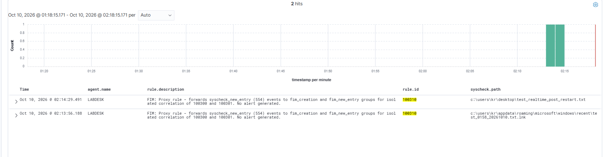

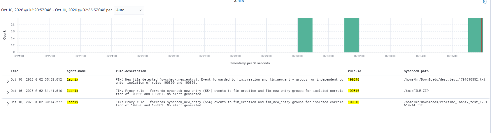

### File creation - 554 and 100300 (labnix)

16 hits for 554 (`p100301v3.txt` created on 2026-10-09 at 20:51:17, realtime mode) and 22 hits for 100300 in 24 hours.

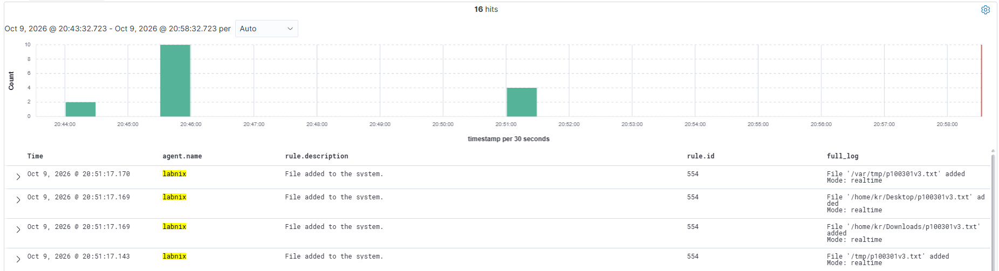

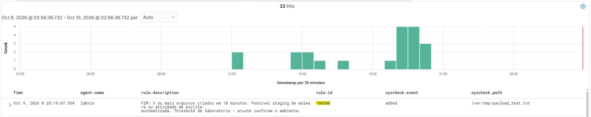

### Same hash in distinct directories - 100301 (pentlab)

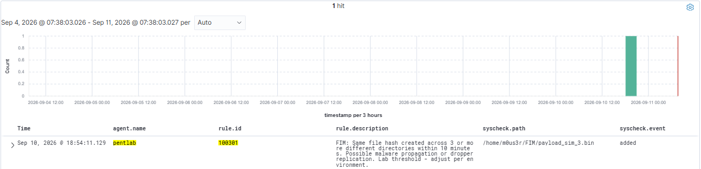

### File modification - 550 and 100302 (labnix)

25 hits for 550 (`elif.zip` and `file.zip` modified on 2026-10-09 at 23:51) and 100302 on `beacon_test.sh`.

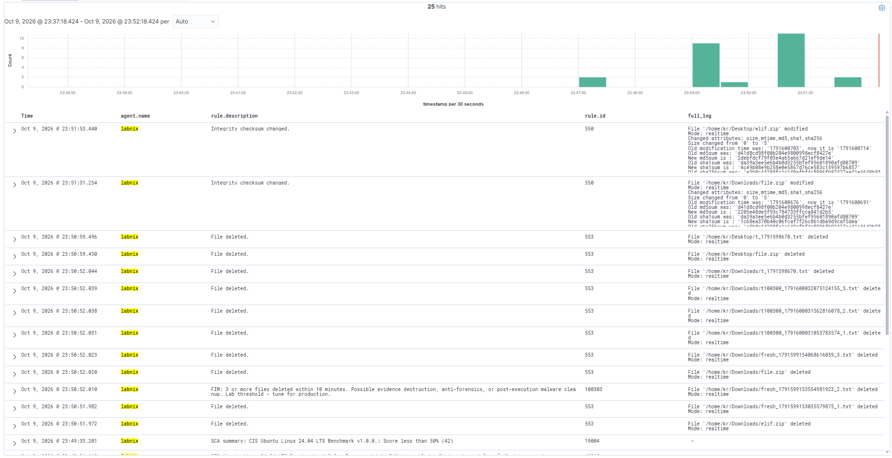

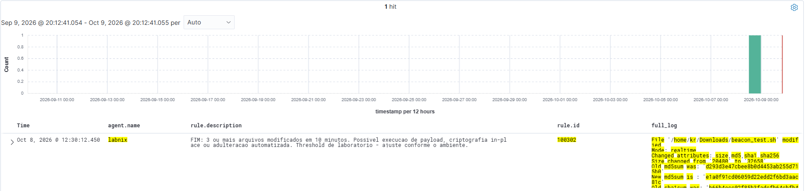

### File deletion - 553 and 100303 (labnix)

34 hits for 553 between 23:08 and 23:15 on 2026-10-09, with 100303 at 23:08:33 and 23:15:16.

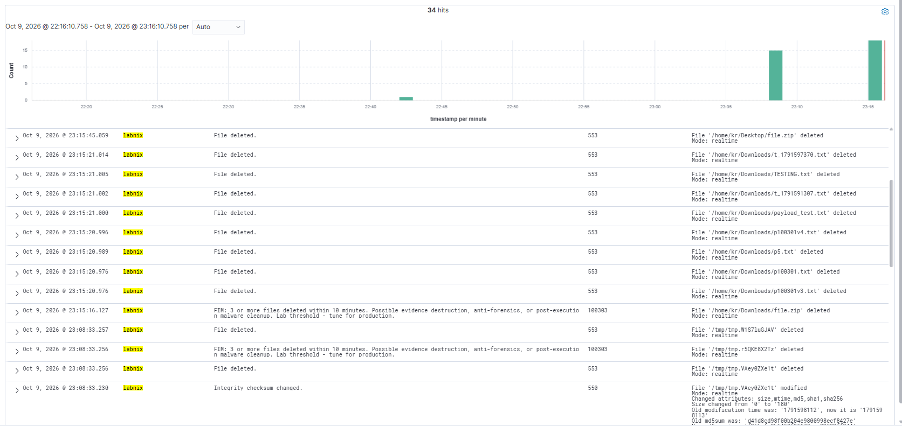

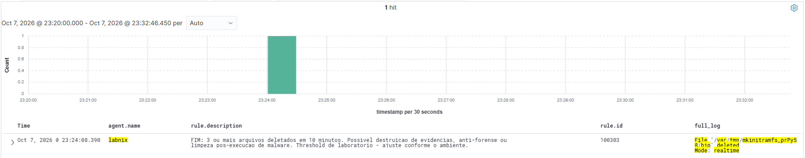

### Escalation - 100304 (LABDESK)

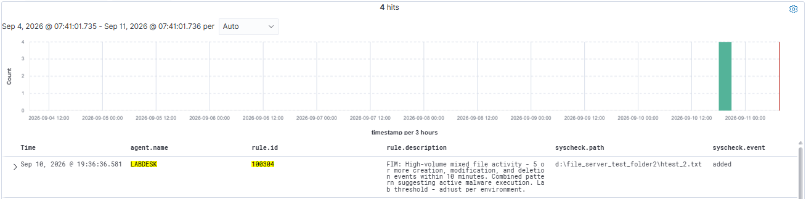

### FIM Alert Investigation - post-exploitation simulation on Windows

The `up.ps1` script ran three phases on LABDESK: staging, reconnaissance (11 commands) and lateral copy. Result: 44 FIM alerts, rule 100302 fired, FIM + process tree correlation (EventID 4688) confirmed.

The panel lists the proxy rule 100310 (level 5) next to the correlation alert 100302, so the creation of `up.ps1` can be analyzed from the alert that actually reaches `wazuh-alerts-*` (finding AC-7). Verdict values vary with the focal alert and the context window: this run starts from the creation alert (risk_score 92), while the run further below starts from 100302 (risk_score 87).

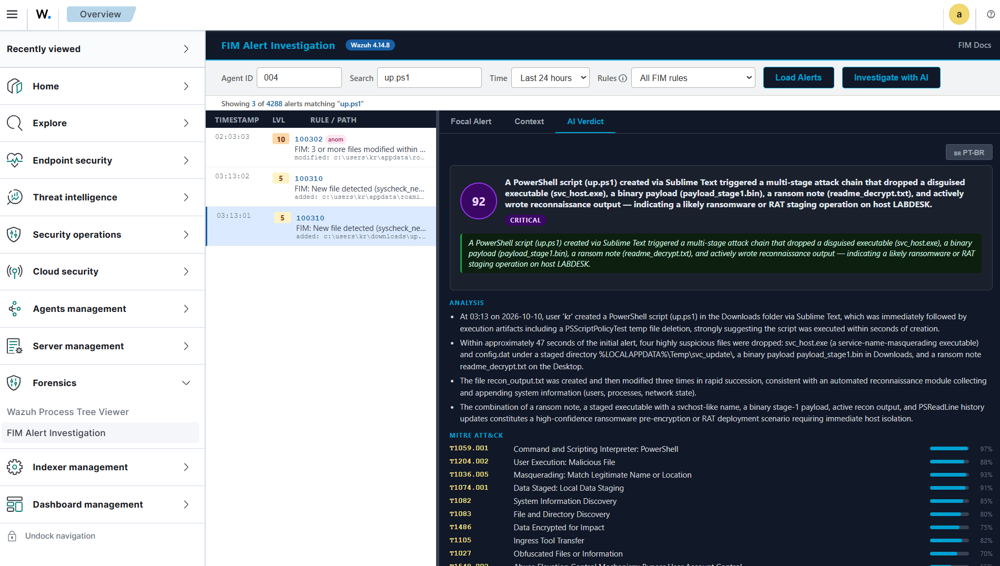

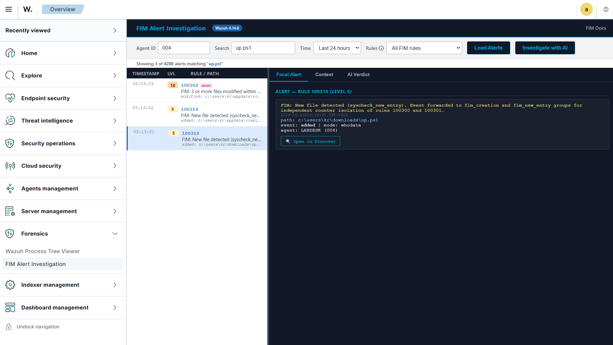

Starting from the escalation alert 100302 instead:

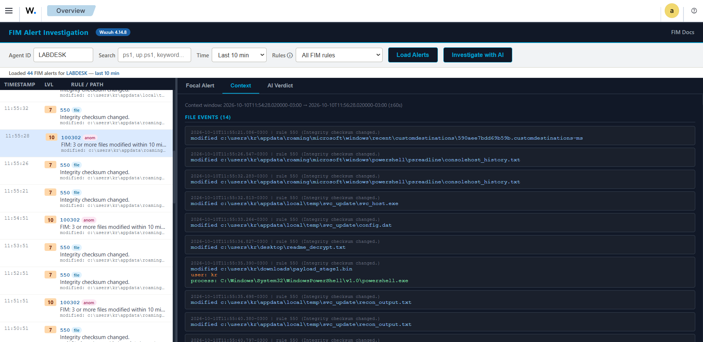

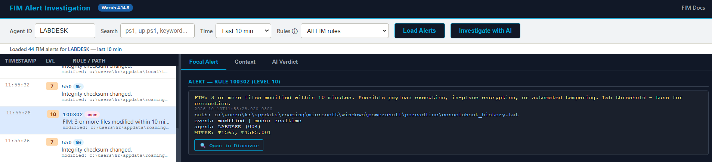

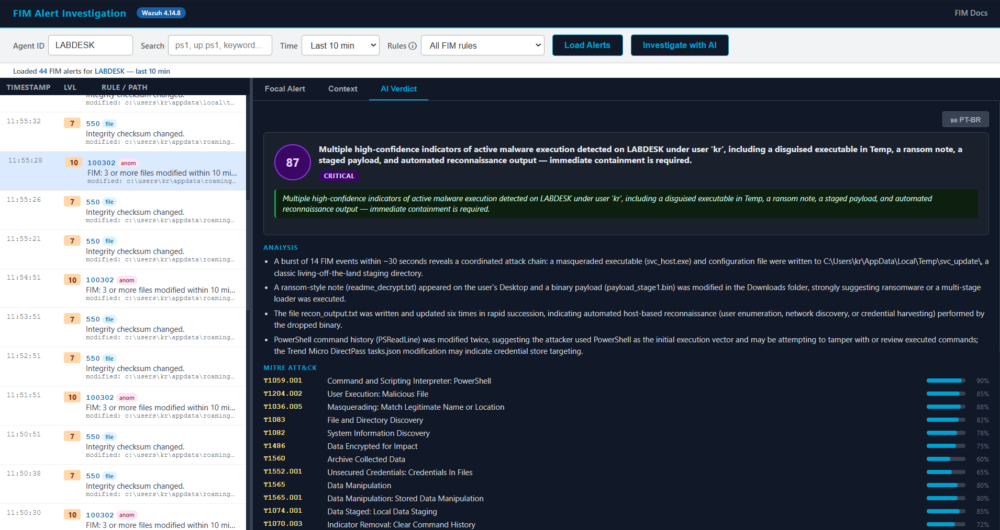

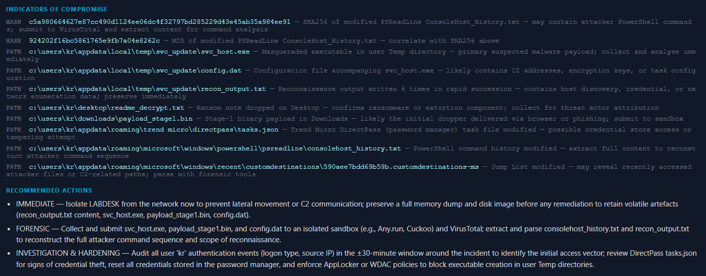

### Validated output on Linux (labnix, 2026-10-06)

```
Focal alert: PROC_CONTEXT.txt added in /home/kr/Downloads/
±60 s context: 8 process events with key: lpe_quartet_root_netlink_route

LLM verdict:
  risk_score: 50 | risk_level: MEDIUM
  T1068 Exploitation for Privilege Escalation - 52% confidence
  IOC: /usr/bin/vmtoolsd triggering the LPE audit key
  Action: audit vmtoolsd integrity and correlate the audit key
          across the full SIEM timeline
```

---

## Sysmon as a Complementary Layer to FIM

The focus of this project is Wazuh FIM. Sysmon enters only as an additional layer: it answers **which process** touched the file, while FIM answers **what changed** (hash, size, attributes). The two signals are paired by path (`syscheck.path` on the FIM side, `data.win.eventdata.targetFilename` on the Sysmon side) and by time.

The tests used the [Unified Sysmon Configs](https://github.com/mym0us3r/Unified-Sysmon-Configs) repository as the base. From it, a new set of rules aimed at research was written and is made available on GitHub for the community to test, modify and adapt to the reality of the environment where it will be deployed. The Sysmon rule IDs start at 100500, so they do not collide with the FIM rules (100300 to 100310).

File: `/var/ossec/etc/rules/fim_sysmon_rules.xml` (permissions `660 wazuh:wazuh`).

| Rule | Level | Sysmon event | Trigger | MITRE | FIM pair |
|---|---|---|---|---|---|
| 100521 | 10 | EID 2 (file creation time changed) | Timestamp changed by an interpreter (`powershell`, `pwsh`, `cmd`, `wscript`, `cscript`, `mshta`, `rundll32`, `regsvr32`) | T1070.006 | 550 (attribute `mtime`, whodata) |
| 100540 | 12 | EID 11 (file created or overwritten) | Executable or script (`exe`, `dll`, `ps1`, `bat`, `vbs`, `js`, `hta`, `lnk` and others) created in a watched path by an interpreter | T1105, T1059 | 100310 (proxy for 554) |
| 100541 | 6 | EID 11 | Any file created or overwritten in a watched path | - | 100300 or 100302 |
| 100554 | 12 | EID 26 (file delete logged) | Executable or script deleted in a watched path by an interpreter | T1070.004 | 553 or 100303 |
| 100555 | 6 | EID 26 | Any file deleted in a watched path | T1070.004 | 553 or 100303 |

### Validated pairs

One run of each scenario on LABDESK (2026-10-12, local time). The arrival order of the two signals varies, so pair them by path and time, not by sequence.

| Scenario | FIM | Sysmon |
|---|---|---|
| Create `.txt` | 100300 at 13:44:42.298 (whodata) | 100541 at 13:44:42.271 |
| Overwrite via `cmd` | 100302 at 14:28:43.364 (scheduled, size 22 to 29) | 100555 at 14:18:57.882 and 100541 at 14:18:57.966 |
| Delete `.txt` | 553 at 15:02:10.064 | 100555 at 15:02:10.109 |
| Drop of an executable by PowerShell | 100310 at 15:42:02.912 (scheduled, SHA-256 `23240ef9...af56cd3`, size 98304) | 100540 at 15:41:56.911 |
| Timestomping of `mtime` | 550 at 15:51:25.303 (whodata, `mtime` 1791831076 to 1559386800) | 100521 at 15:51:25.264 |
| Cleanup: delete script and executable | 553 at 15:56:09.851 and 100303 at 15:56:10.793 | 100555 at 15:56:09.864 and 100554 at 15:56:09.893 |

**FIM-only cases.** `Set-Content` overwrite (550 at 14:14:09.810), append (550 at 14:38:54.918) and `Rename-Item` (553 and 100310 at 14:51:45.810) produced no event on the Sysmon channel. In these cases FIM is the only source, which is the argument for treating Sysmon as a layer and not as a replacement.

### Deployment

```bash
# 1. WZ-SRV: copy the rules, fix ownership and validate before restarting
cp sysmon/fim_sysmon_rules.xml /var/ossec/etc/rules/
chown wazuh:wazuh /var/ossec/etc/rules/fim_sysmon_rules.xml
chmod 660 /var/ossec/etc/rules/fim_sysmon_rules.xml
/var/ossec/bin/wazuh-analysisd -t
systemctl restart wazuh-manager
```

On the endpoint, Sysmon must log EID 2 (file creation time changed), EID 11 (file created) and EID 26 (file delete logged) for the monitored path, otherwise the rules have nothing to match. Start from the native configurations in the [Unified Sysmon Configs](https://github.com/mym0us3r/Unified-Sysmon-Configs) repository, enable these three event types for the path under test and apply the result from an elevated PowerShell with `sysmon64 -c <configuration>.xml`.

Discover query that shows both signals from the monitored folder:

```
agent.name: "LABDESK" and (syscheck.path: *fim_sysmon_lab* or data.win.eventdata.targetFilename: *fim_sysmon_lab*)
```

### Technical notes

- Windows paths are stored with doubled backslashes, so the PCRE2 expressions use four (`\\`) per separator.
- Stock Sysmon rules for EID 11 (for example 92203) match first and would shadow later sibling rules. For this reason 100540 and 100541 are children of `61613,92202,92203,92211,92212,92215,92223,92227`.
- Rules 100554 and 100555 hang from `<if_group>sysmon_event_26</if_group>`.
- Use the `timestamp` field for time comparison. `syscheck.mtime_after` is displayed 3 hours earlier in Discover.
- Frequency rules that tried to correlate the two sources did not fire in the Create and Delete tests, in either arrival order. They were removed, and pairing is done in Discover with the query above.

> **Adaptation warning:** the watched path (`File_Server_Test_Folder`), the levels and the interpreter list are lab values. Adjust them to the environment before using the rules in production.

Evidence (real captures from Wazuh Discover):

The figure numbers follow the Handbook (section 8.5). Figure 56 is a terminal capture; Figures 57 to 67 are Wazuh Discover queries, and each caption lists the `rule.id` of the alerts shown.

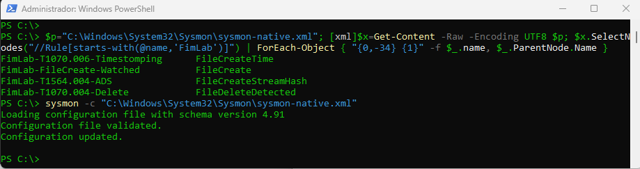

*Figure 56 - Sysmon XML validation and application of the native Sysmon configuration with sysmon -c on LABDESK (schema 4.91)*

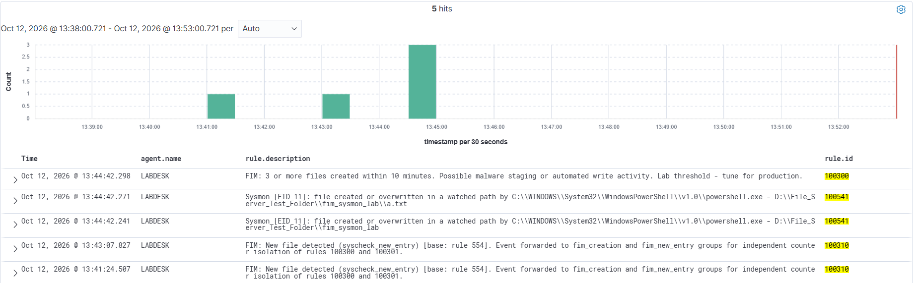

*Figure 57 - Creation of a.txt on LABDESK: rule 100541 (Sysmon, EID 11, 13:44:42.241 and 13:44:42.271) followed by 100300 (FIM, 13:44:42.298)*

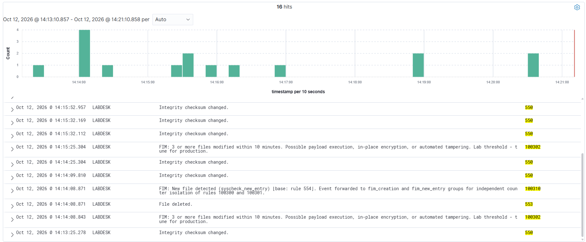

*Figure 58 - Overwrite with Set-Content: alert 550 (FIM) at 14:14:09.810, with no associated Sysmon alert (range 14:13 to 14:21)*

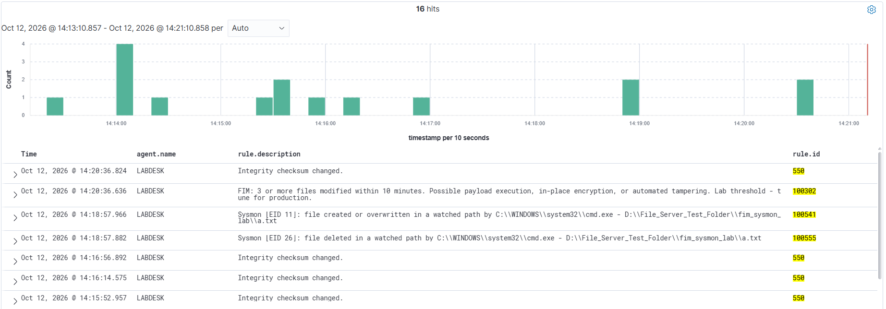

*Figure 59 - Overwrite with cmd.exe redirection: rules 100555 (Sysmon, EID 26, 14:18:57.882) and 100541 (Sysmon, EID 11, 14:18:57.966) with image cmd.exe*

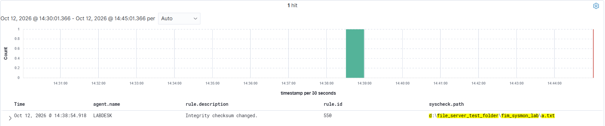

*Figure 60 - Append a line to a.txt: combined query by path (FIM or Sysmon) returns only alert 550 (FIM) at 14:38:54.918*

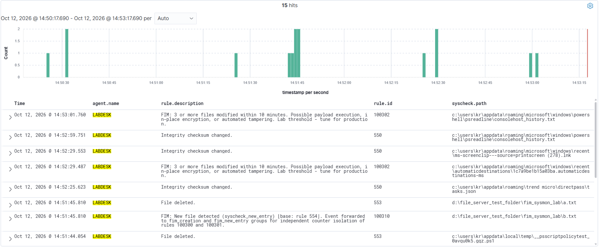

*Figure 61 - Rename files: FIM alerts 553 (a.txt) and 100310 (b.txt) at 14:51:45.810, with no associated Sysmon alert*

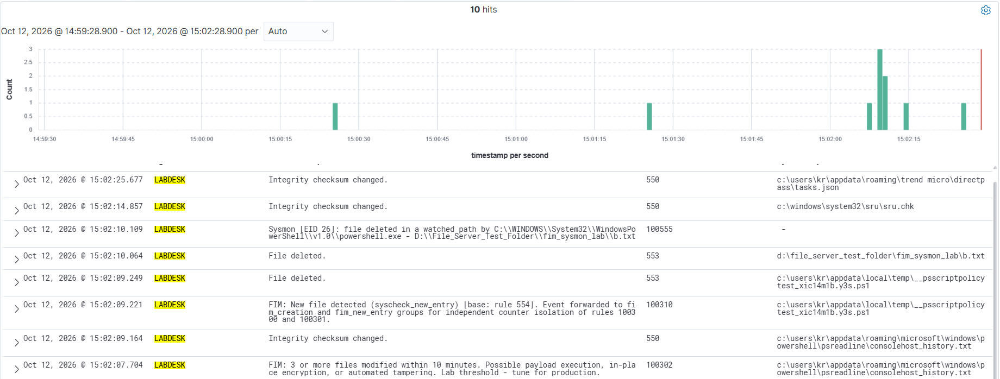

*Figure 62 - Deletion of b.txt: alert 553 (FIM) and alert 100555 (Sysmon, EID 26) on the same path*

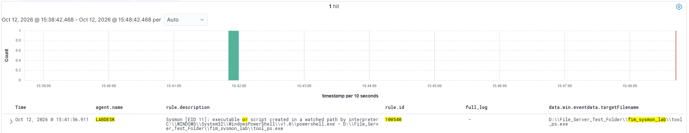

*Figure 63 - Copy of the executable tool_ps.exe by PowerShell: alert 100540 (Sysmon, EID 11)*

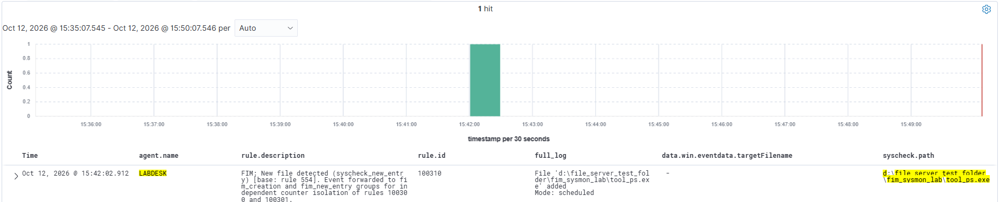

*Figure 64 - Same executable in FIM: alert 100310 (proxy for 554, scheduled mode) with the file's MD5 and SHA-256 hashes*

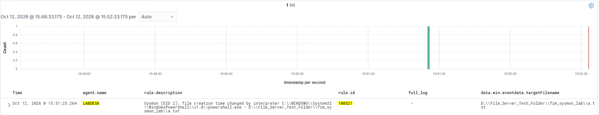

*Figure 65 - Change of a.txt dates (timestomp): alert 100521 (Sysmon, EID 2)*

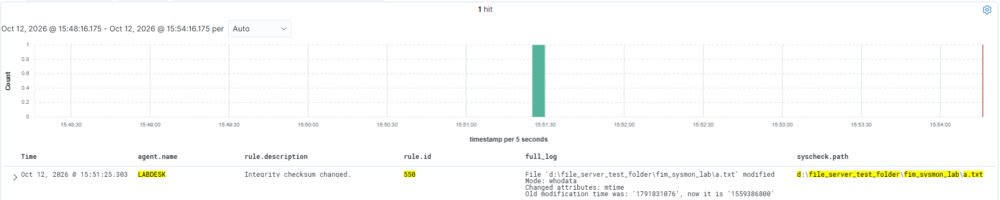

*Figure 66 - Same operation in FIM: alert 550 (whodata mode) with the mtime attribute changed*

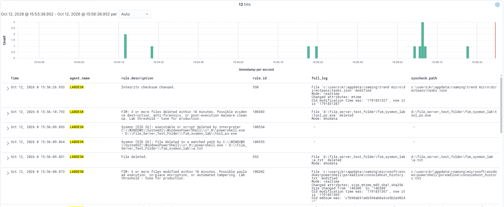

*Figure 67 - Cleanup of the test files: 553 and 100555 (a.txt), 100554 (Sysmon, EID 26) and 100303 (FIM) for tool_ps.exe*

---

## MITRE ATT&CK Mapping

| Technique | ID | Rules |
|---|---|---|
| Data Manipulation | T1565 | 100300, 100302, 100304 |
| Stored Data Manipulation | T1565.001 | 100300, 100302 |
| Data Staged | T1074 | 100300 |
| Ingress Tool Transfer | T1105 | 100301, 100540 |
| Lateral Tool Transfer | T1570 | 100301 |
| Data Destruction | T1485 | 100303, 100304 |
| Indicator Removal | T1070 | 100303 |
| Timestomp | T1070.006 | 100521 |
| File Deletion | T1070.004 | 100554, 100555 |
| Command and Scripting Interpreter | T1059 | 100540 |
| Disk Wipe | T1561 | 100303 |
| Data Encrypted for Impact | T1486 | 100304 |

Chapter 9 of the Handbook also covers compliance mapping (PCI DSS 4.0, NIST 800-53 Rev 5, HIPAA, GDPR and SOC 2).

---

## Handbook Contents

The Handbook is written in PT-BR. Chapters:

| Chapter | Content |
|---|---|
| 1. Sumário Executivo | Results, structure and reference environment |
| 2. Fundamentos do FIM | Architecture, the three modes, parameters, network paths and delta sync |
| 3. FIM em Windows | SACL, `auditpol`, GPO, `windows_audit_interval`, rename and Registry |
| 4. FIM em Linux | auditd, persistent rules, audit-keys CDB, eBPF provider, inotify and troubleshooting |
| 5. Regras de Detecção de Anomalia | Six rules, the 100310 proxy pattern and per-platform evidence |
| 6. FIM Alert Investigation | Architecture, threat intelligence, LLM verdict and validations |
| 7. Regras Complementares | Agent lifecycle (504, 505, 506), inotify overflow (560) and Registry |
| 8. Perspectiva do Adversário | Evasion, timestomping, ransomware event pattern and Sysmon as a complementary layer (8.5) |
| 9. Compliance e MITRE ATT&CK | PCI DSS, NIST, HIPAA, GDPR, TSC and techniques |
| 10. Achados Técnicos | 15 validated findings and 1 refuted hypothesis |
| 11. Configurações de Referência | What is new in 4.14.8, hardened `ossec.conf`, server state |

---

## Security

WPTV and FIM Alert Investigation are analyst tools for a lab or an administrator network. Review the points below before deploying them.

**Access control.** The Flask service listens on `127.0.0.1:5000` only and has no authentication of its own. Nginx routes `/wptv/`, `/fim/` and `/api/fim/` directly to it, so these paths do not go through the Wazuh Dashboard login. The `allow YOUR-ADMIN-IP; deny all;` rule in `wptv-fim/wptv.nginx.conf` is the only access control for them. Keep it restricted to administrator addresses.

**Indexer access.** The service reads from the Wazuh Indexer with the read-only user `wptv_svc` (role `wptv_role`, indices `wazuh-alerts-*` and `wazuh-archives-*`). See [Step 3](#step-3---wazuh-indexer-credentials-service-user-wptv_svc).

**Secrets.** The Indexer password and the API keys live in `/etc/wazuh-process-tree/wptv.env` (mode `600`, owner `wazuh-dashboard`). The repository ships only `wptv-fim/wptv.env.example` with placeholders. `.gitignore` excludes `wptv.env`, `*.env` (except `*.env.example`), `*.pem` and `*.key`.

**TLS.** `proxy_ssl_verify off` applies only to the loopback hops between nginx and the local services. Set `WPTV_INDEXER_CA_CERT` in `wptv.env`: without it, certificate verification of the Indexer connection is disabled and a warning is written to the log.

**Data sent to third parties.** All features below are optional and stay off while their key is unset in `wptv.env`.

| Feature | Destination | Data sent |
|---|---|---|
| AI ANALYZE (WPTV) | Anthropic API | Host, IP and agent ID, process names, user, first 200 characters of the command line, file paths, parent-child relations |
| Investigate with AI (FIM Alert Investigation) | Anthropic API | Rule IDs and descriptions, file and registry paths, event types, user and process names, hashes, process events in the ±60 s window, threat intelligence results |
| Threat intelligence enrichment | VirusTotal and AlienVault OTX; AbuseIPDB | SHA256 of the file (VirusTotal, OTX); IP addresses found in the event context (AbuseIPDB) |

Do not enable these features where paths, hostnames or command lines cannot leave the organization. Each analysis request also consumes Anthropic API quota, which is one more reason to keep the nginx restriction in place.

To report a vulnerability, see [SECURITY.md](SECURITY.md).

---

## Validation Limits

- The formal controlled-threshold test of rules 100300 to 100304, with documented scenarios on LABDESK and labnix, is an open step. Current evidence comes from simulation scripts and real indexed alerts.
- Rule 100301 was not confirmed on Windows.
- The correlation parameters are lab values and require a baseline in production.
- The manager runs syscheck with `frequency` 60 s (lab value, to speed up validation). The LABDESK and LABNIX endpoints keep `frequency` 3600 s, because the monitored paths use `realtime` or `whodata`.
- The Sysmon rules are a research ruleset, validated with one run of each scenario on LABDESK. Sysmon complements FIM and does not replace it: some operations (overwrite with `Set-Content`, append, rename) produced no Sysmon event in the tests.
- Frequency rules across the two sources (FIM and Sysmon) did not fire in the tests, so the pairing is done in Discover by path and time.

---

## References

- [Wazuh FIM documentation](https://documentation.wazuh.com/current/user-manual/capabilities/file-integrity/index.html)
- [Custom FIM rules](https://documentation.wazuh.com/current/user-manual/capabilities/file-integrity/creating-custom-fim-rules.html)
- [Syscheck configuration](https://documentation.wazuh.com/current/user-manual/reference/ossec-conf/syscheck.html)
- [Release notes 4.14.8](https://documentation.wazuh.com/current/release-notes/release-4-14-8.html)
- [MITRE ATT&CK - T1565 Data Manipulation](https://attack.mitre.org/techniques/T1565/)
- [MITRE ATT&CK - T1485 Data Destruction](https://attack.mitre.org/techniques/T1485/)
- [MITRE ATT&CK - T1486 Data Encrypted for Impact](https://attack.mitre.org/techniques/T1486/)
- [MITRE ATT&CK - T1105 Ingress Tool Transfer](https://attack.mitre.org/techniques/T1105/)
- [Unified Sysmon Configs](https://github.com/mym0us3r/Unified-Sysmon-Configs)
- [Sysmon - Microsoft Sysinternals](https://learn.microsoft.com/en-us/sysinternals/downloads/sysmon)
- [WAZUH-Process-Tree-Viewer](https://github.com/mym0us3r/WAZUH-Process-Tree-Viewer)

---

## Author

**Kislley Rodrigues (m0us3r)**
Wazuh Ambassador | Detection Engineering | Blue Team

---

## Acknowledgments

- **Wazuh Team** for the open source SIEM/XDR platform and the Ambassador Program

---

*Detection rules, FIM Alert Investigation panel and agent configurations validated on Wazuh 4.14.8, Windows 11 Pro build 26200, Sysmon schema 4.91, Ubuntu 24.04.5 kernel 6.17.0 and Claude Sonnet 4.6.*

---

## Update 2026-10-11

| Change | Detail |
|---|---|
| Hypothesis AP-1 refuted | The suspected stall of the `syscheckd` inotify reader on labnix was not confirmed: realtime delivers events (41 events in the window, 36 in realtime mode). Not an upstream issue. |
| Handbook revised | 53 pages, 15 validated findings and 1 refuted hypothesis, with 9 new Wazuh Discover screenshots and a caption on every figure. |
| Indexer access documented | WPTV and FIM Alert Investigation query the Wazuh Indexer with the read-only service user `wptv_svc` (role `wptv_role`, indices `wazuh-alerts-*` and `wazuh-archives-*`). Credentials in `/etc/wazuh-process-tree/wptv.env`. |
| Verification rule | Confirm realtime through `syscheck.mode` in `archives.json`, use `strace -y` including `pselect6`, and do not query the live `fim.db`. |

---

## Update 2026-10-12

| Change | Detail |
|---|---|
| Sysmon as a complementary layer | Five research rules (100521, 100540, 100541, 100554, 100555) paired with the FIM rules by path and time, built from the [Unified Sysmon Configs](https://github.com/mym0us3r/Unified-Sysmon-Configs) repository. Available to the community to test, modify and adapt. |
| Pairs validated | Create, overwrite via `cmd`, delete, executable drop, timestomping and cleanup, each with the FIM alert and the Sysmon alert on the same path. |
| FIM-only cases documented | `Set-Content` overwrite, append and rename produced no Sysmon event: FIM is the only source in these cases. |
| Handbook revised | 60 pages, with the new section 8.5 "Sysmon como Camada Complementar ao FIM". |

---

## Wazuh

This project was developed as part of the [Wazuh Ambassador Program](https://wazuh.com/ambassadors-program/?utm_source=ambassadors&utm_medium=referral&utm_campaign=ambassadors+program).

Wazuh is a free, open source security platform that provides unified XDR and SIEM protection.
Learn more at [wazuh.com](https://wazuh.com/?utm_source=ambassadors&utm_medium=referral&utm_campaign=ambassadors+program).
